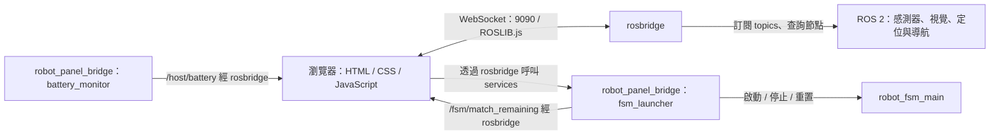

# Robot Panel UI

TDK 機器人控制面板，以 HTML、CSS、JavaScript 搭配內附的 ROSLIB.js 實作，**不需要 npm 或編譯**，開啟即可使用。

本專案保留作為個人作品與後續學弟的實作參考，展示如何將 ROS 2 的狀態監控、任務操作與比賽資訊整合成瀏覽器介面。以下 topic、service、節點名稱與場地流程依當時機器人系統設計；移植到其他機器人時，需配合自己的後端調整。

## 功能

- **狀態監控**：快速查看機器人各部分狀態，包含底盤里程計、視覺辨識、機構通訊、Nav2、定位訊息、前後 LiDAR 與主機電池等。
- **比賽快速啟動**：透過面板直接啟動對應場地的主程式（normal / mirror）。在 1 分鐘準備時間開始前就能全部設定完成，比賽開始後按下對應的 `START NORMAL` 或 `START MIRROR` 即可啟動主程式，也支援 reset。
- **遠端測試**：測試時可用筆電遠端監控，並啟動 / 停止主程式。

### 筆電遠端連線畫面


### 比賽現場


### 指示燈說明


## 本機使用


1. 啟動機器人的定位與導航（`Loc_Normal`、`Loc_Mirror` 或 `Loc_DIT`），並確認 `rosbridge` 與 `robot_panel_bridge` 的 `fsm_launcher` 已啟動。


2. 開啟 robot_panel，確認各部分狀態正常。
3. 選擇與已載入地圖一致的模式：`START NORMAL`、`START MIRROR`、`START MIRROR V2` 或 `START DIT`。
4. 其他操作：
   - **STOP**：停止 FSM 並取消導航。
   - **RESET TO STAGE 2 / 3**：保留定位、截止時間及路線選擇，從指定關卡重新執行。

> 實際行為由配套後端決定。

## 區網使用

在機器人電腦的此目錄執行：

```bash
python3 -m http.server 8000 --bind 0.0.0.0
```

接著在另一台電腦開啟 `http://<機器人IP>:8000`，面板會使用網址中的主機位址連線至 rosbridge。

> 請確認 **8000**、**9090** port 可互通。

### 連線設定

連線參數位於 `app.js` 的 `CONFIG`：

| 服務 | Port |
| --- | --- |
| rosbridge | 9090 |
| Foxglove WebSocket | 8767 |
| Lichtblick | 8080 |

目前使用 `ws://`；若部署至 HTTPS 網站，需另行設定 WSS 與機器人連線。

## 系統架構



面板負責顯示與發送操作請求；FSM 執行、場地檢查、導航取消與比賽截止時間由後端處理。只下載此 repo 可以查看介面，連接實機則需要配套的 ROS 環境與後端。

上方 `ROBOT PANEL` 連結會開啟 Lichtblick，並帶入 Foxglove WebSocket 連線參數；這是獨立的視覺化工具，需要另外啟動。

## 指示燈與 ROS 來源對照

### 燈色與更新方式

| 顏色 | 意義 |
| --- | --- |
| 綠色 | 目前符合該項目的判斷條件 |
| 紅色 | 未符合條件，例如訊息逾時、topic／節點不存在或 rosbridge 斷線 |
| 灰色 | 狀態尚未取得；程式也保留此顏色供尚未實作的項目使用 |

訊息新鮮度門檻為 **2 秒**（`livenessTimeoutMs`），每 **500 ms** 檢查一次；topic／節點清單每 **1.5 秒**（`pollIntervalMs`）查詢一次，因此燈號切換可能稍有延遲。衍生狀態由其他燈號組合計算，初始化時可能直接顯示紅色。

### SYSTEM STATUS

| 指示燈 | ROS 來源 | 訊息型別／來源種類 | 亮綠燈條件 |
| --- | --- | --- | --- |
| CHASSIS | `/odom` | `nav_msgs/msg/Odometry` | 最近 2 秒內收到訊息 |
| MISSION | `/mechanism/command` ＋ `/mechanism/straw_pick_status` | topic 存在檢查 ＋ `robot_interfaces/msg/StrawPickStatus` | command 出現在 topic 清單，且最近 2 秒內收到 straw_pick_status |
| VISION | `/straw/target` | `straw_interfaces/msg/StrawTarget` | 最近 2 秒內收到訊息 |
| NAVIGATION | `/bt_navigator` | ROS 節點 | 節點出現在 ROS graph |
| LOCALIZATION | `/robot_pose` | `geometry_msgs/msg/PoseStamped` | 最近 2 秒內收到訊息 |

`/mechanism/command` 是按需發送的指令，因此使用 topic 存在檢查，避免沒有新指令時誤判機構離線；機構回傳則以持續更新的 `/mechanism/straw_pick_status` 判斷。

### DEVICE STATUS

| 指示燈 | Topic | 訊息型別 | 亮綠燈條件 |
| --- | --- | --- | --- |
| ODOMETRY | `/odom` | `nav_msgs/msg/Odometry` | 最近 2 秒內收到訊息 |
| FRONT_LIDAR | `/front/scan` | `sensor_msgs/msg/LaserScan` | 最近 2 秒內收到訊息 |
| REAR_LIDAR | `/rear/scan` | `sensor_msgs/msg/LaserScan` | 最近 2 秒內收到訊息 |
| CAMERA | `/straw/target` | `straw_interfaces/msg/StrawTarget` | 最近 2 秒內收到訊息 |

### ROBOT STATE

| 指示燈 | 判斷條件 |
| --- | --- |
| COMMUNICATION READY | ODOMETRY 與 MISSION 都正常 |
| LOCALIZATION READY | LOCALIZATION 與 NAVIGATION 都正常 |
| FSM_RUNNING | ROS graph 中存在 `/robot_fsm_main` 節點 |

### 如何解讀燈號

- CHASSIS 與 ODOMETRY 使用相同的 `/odom`；VISION 與 CAMERA 使用相同的 `/straw/target`，分別顯示於系統與裝置區塊。
- VISION／CAMERA 只檢查訊息是否持續更新；即使辨識結果 `valid: false`，仍會亮綠燈。這代表視覺流程有輸出，不代表找到目標。
- LOCALIZATION 只表示定位訊息持續更新，定位位置與朝向是否正確仍需查看地圖。
- NAVIGATION／FSM_RUNNING 依節點存在判斷，無法單靠綠燈確認 Nav2 lifecycle 狀態、導航成功或任務進度。
- FRONT_LIDAR／REAR_LIDAR 只檢查掃描訊息更新，未檢查量測值品質。

## 操作按鈕與 ROS services

所有操作均使用 `std_srvs/srv/Trigger`，由 `robot_panel_bridge` 的 `fsm_launcher` 提供。按下後，按鈕下方會顯示後端回傳的訊息；呼叫失敗或後端回覆 `success: false` 時顯示錯誤樣式。

| 按鈕 | Service | 配套後端行為 |
| --- | --- | --- |
| START NORMAL | `/fsm/start_normal` | 啟動 normal 場地主程式，設定新的比賽截止時間 |
| START MIRROR | `/fsm/start_mirror` | 啟動 mirror 原版路線，設定新的比賽截止時間 |
| START MIRROR V2 | `/fsm/start_mirror_v2` | 使用 mirror 場地，第三關掃描順序為 row3 → row1 → row2 |
| START DIT | `/fsm/start_dit` | 使用 DIT 測試場地，僅執行第三關 |
| STOP ROBOT_FSM_MAIN | `/fsm/stop` | 發送零速度、停止 FSM 並取消 Nav2 導航目標 |
| RESET TO STAGE 2 | `/fsm/reset_stage2` | 停止舊 FSM，再從第二關準備流程啟動 |
| RESET TO STAGE 3 | `/fsm/reset_stage3` | 停止舊 FSM，經轉角與第三關入口重新進入第三關 |

START 必須符合後端已載入的場地；MIRROR V2 同樣使用 mirror 地圖。START 成功代表後端接受啟動請求，仍需配合節點狀態與 log 確認後續執行。

STOP 與 RESET 保留原有比賽截止時間；RESET 也保留定位與路線選擇。重新按 START 才設定新的截止時間。此操作依賴常駐 launcher 的狀態，重啟 launcher 後不能假設原倒數仍保留。

## 電量與比賽倒數

| 項目 | Topic | 訊息型別 | 說明 |
| --- | --- | --- | --- |
| 主機電池 | `/host/battery` | `sensor_msgs/msg/BatteryState` | 機器人主機的電池，不是觀看面板的遠端筆電或底盤電池 |
| 比賽倒數 | `/fsm/match_remaining` | `std_msgs/msg/Float64` | 後端提供剩餘秒數，面板在訊息之間自行更新顯示 |

電池低於 **40%** 顯示黃色，低於 **20%** 顯示紅色；超過 **5 秒**沒有新訊息時顯示 `NO DATA`。功率使用電壓乘以電流絕對值估算；剩餘／充滿時間需有有效電量與電流資料才能計算，資料不足時顯示 `--`。

倒數尚未收到訊息時顯示 `--:--`，低於 **60 秒**顯示黃色，低於 **30 秒**顯示紅色，最低顯示 `00:00`。比賽時長由後端設定，前端沒有固定時長；顯示歸零也不代表前端會發送 STOP。

rosbridge 斷線時燈號會轉為紅色、電量與倒數清空，約 2 秒後重試連線。若只有倒數 topic 停止更新而 WebSocket 仍連線，面板會沿用最後收到的剩餘時間繼續倒數，目前沒有獨立的倒數資料逾時提示。

## 常見問題與排查

以下指令請在已載入 ROS 環境及相關 workspace 的終端機執行。

| 現象 | 優先檢查 |
| --- | --- |
| 多數燈號全紅 | rosbridge 是否啟動、9090 port 是否可連線，以及瀏覽器 Console 的 WebSocket 錯誤 |
| CHASSIS／ODOMETRY 紅燈 | `/odom` 是否持續輸出、micro-ROS 與底盤連線是否正常 |
| MISSION 紅燈 | `/mechanism/command` 是否存在，以及 `/mechanism/straw_pick_status` 是否持續更新 |
| VISION／CAMERA 紅燈 | 視覺節點是否啟動，`/straw/target` 是否持續更新 |
| NAVIGATION 紅燈 | `/bt_navigator` 節點是否存在 |
| LOCALIZATION 紅燈 | `/robot_pose` 是否持續更新 |
| START 被拒絕 | 場地是否與已載入地圖一致、FSM 是否已在執行，以及按鈕下方的後端回覆 |
| 電量為 NO DATA | battery_monitor 是否啟動，主機是否能提供電池資料 |
| 本機可用、遠端不可用 | HTTP server 綁定位址、機器人 IP、網路與 8000／9090 port |

```bash
# 查看節點與 topics
ros2 node list
ros2 topic list

# 查看訊息更新頻率與來源資訊
ros2 topic hz /odom
ros2 topic hz /mechanism/straw_pick_status
ros2 topic hz /straw/target
ros2 topic info /mechanism/command

# 查看後端操作介面與倒數
ros2 service list
ros2 topic echo /fsm/match_remaining
```

在另一台電腦直接開啟下載的 `index.html` 時，`file://` 模式會連線到那台電腦的 `localhost:9090`。若後端在機器人上，請使用前述 `http://<機器人IP>:8000` 方式。

## 專案結構與移植參考

```text
robot_panel_ui/
├── index.html             # 版面、燈號與操作按鈕
├── style.css              # 配色、狀態樣式與響應式版面
├── app.js                 # ROS 連線、狀態判斷、service 操作與資訊顯示
├── assets/robot-model.png  # 機器人展示圖片
└── vendor/roslib.min.js    # 瀏覽器端 ROS 通訊函式庫
```

移植時可以從以下位置調整：

| 需求 | 修改位置 |
| --- | --- |
| 更換 topic、訊息型別或節點名稱 | `app.js` → `CONFIG.topics` |
| 調整訊息逾時與查詢週期 | `CONFIG.livenessTimeoutMs`、`CONFIG.pollIntervalMs` |
| 更換 START／STOP／RESET service | `CONFIG.fsmStartServices`、`fsmStopService`、`fsmResetStage2Service`、`fsmResetStage3Service` |
| 調整電量與倒數門檻 | `CONFIG.hostBattery`、`CONFIG.matchTimer` |
| 更換機器人圖片 | `assets/robot-model.png` 或 `CONFIG.robotModelImage` |
| 修改組合狀態邏輯 | `computeDerivedStates()` |
| 增加燈號或按鈕 | `index.html` 與 `app.js` 對應設定及事件綁定 |

新增狀態時，需讓 HTML 的 `data-dot`／`data-key` 與程式中的狀態 key 一致。自訂訊息也需先在 ROS 後端建置並載入，讓 rosbridge 能解析。

此實作展示了三種可重用的狀態判斷方式：**訊息新鮮度、topic／節點存在檢查、衍生狀態組合**。可依資料是否持續發布、是否只是按需觸發，選擇合適的判斷方式。
